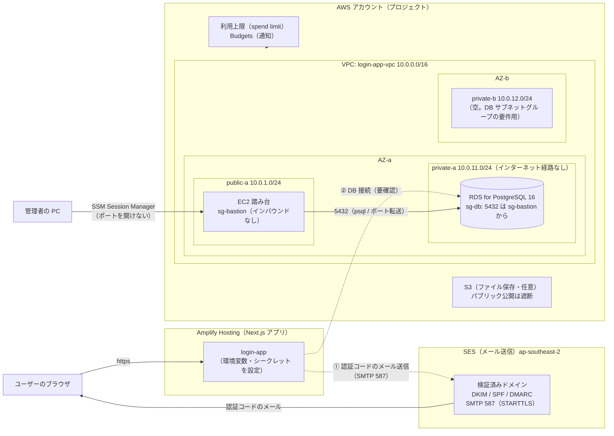

# AWS 入門ガイド（初心者向け・完全版）

このフォルダは、このアプリ（ログイン画面 + PostgreSQL + メール送信）を AWS に載せるまでの手順と、載せた後の運用を、**初めて AWS を触る人向け**にまとめたものです。

「**なぜそれをするのか**」と「**どの順番で、何をクリック（コマンド）するのか**」の両方を書いています。

> **大事な前提**
>
> - 本番環境の作成は、すべて**人間が行う**（Claude などの自動化ツールには任せない）。
> - AWS の画面は頻繁に変わります。画面の名称が違うときは、各ページの「公式ドキュメント」の欄を開いて確認してください。
> - 書いてある金額は目安です。料金は必ず **請求の画面** で確認してください。
> - 手順の多くは「コンソール（ブラウザの画面）」の操作と、同じことを行う「CLI（ターミナルのコマンド）」の両方を載せています。

## アーキテクチャ図（学習構成）

最終的に作る構成です。点線は「まだ確認が必要な接続」を表します。

**図の読み方**

- **インターネットから直接届くのは、Amplify（アプリ）だけ**です。DB（RDS）はインターネットから届かない場所（private-a）に置きます。
- **管理者は、SSM Session Manager で踏み台に入ります。** SSH のポートは開けません。踏み台から DB へ、5432 番だけ通します。
- **AZ-b の private-b は、RDS の要件を満たすための空のサブネット**です。DB は置きません。
- **利用上限と予算**は、構成の外側で費用を監視します。

## 読む順番

| 順番 | ファイル                                           | 中身                                                      | 最初にやる理由                                     |
| ---- | -------------------------------------------------- | --------------------------------------------------------- | -------------------------------------------------- |
| 1    | [00-overview.md](./00-overview.md)                 | 全体像、用語集、このアプリの構成図                        | 何を作るのか、全体像をつかむため                   |
| 2    | [01-account-and-cost.md](./01-account-and-cost.md) | アカウント、MFA、利用上限、予算、リージョン               | **お金と安全の土台**。ここを飛ばすと事故につながる |
| 3    | [02-vpc.md](./02-vpc.md)                           | VPC（仮想ネットワーク）、サブネット、セキュリティグループ | サーバーと DB を置く「家」を先に作る               |
| 4    | [03-ec2.md](./03-ec2.md)                           | EC2（仮想サーバー）、SSM Session Manager での接続         | DB に接続する「踏み台」を作る                      |
| 5    | [04-s3.md](./04-s3.md)                             | S3（ファイル保存）、公開設定、バージョニング              | 比較的安全に始められる                             |
| 6    | [05-rds-postgresql.md](./05-rds-postgresql.md)     | RDS for PostgreSQL（データベース）                        | アプリのデータを置く                               |
| 7    | [06-ses.md](./06-ses.md)                           | SES（メール送信）、SMTP 認証情報、サンドボックス解除      | 認証コードを届ける                                 |
| 8    | [07-operations.md](./07-operations.md)             | 日々の運用、監視、バックアップ、障害対応、後片付け        | 作った後に、長く安全に動かすため                   |

## このガイドの使い方（学習の進め方）

1. まず **01（お金と安全）** を終わらせる。ここが済むまで、他のサービスは作らない。
2. 02〜07 は、**学習用の小さな構成**で試す。各ファイルの最後にある「後片付け」を必ず行う。
3. 07 の運用チェックリストを、毎週 15 分ほど見る習慣をつける。

## 用語の確認

迷ったら [00-overview.md の用語集](./00-overview.md#用語集) を見てください。

## 注意（この環境で確認できたこと・できなかったこと）

- 各ファイルの「公式ドキュメント」の欄のリンクは、2026 年 11 月時点の内容を確認したものです。
- 「要確認」と書いた項目は、公式の記述を確認できなかったか、簡易版（Sign up for AWS (new)）で使えるかが未確認のものです。実際の画面で必ず確かめてください。
